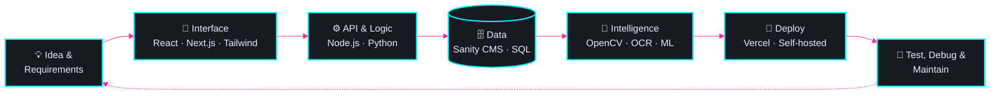
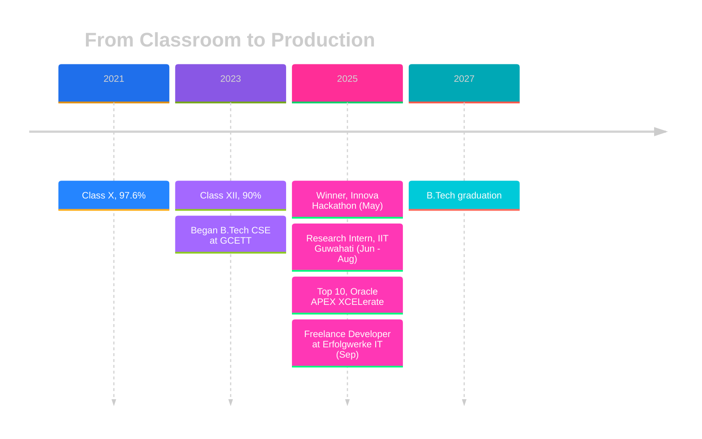

<div align="center">


<a href="https://anwesha-portfolio.vercel.app/">

</a>

<br/>


<br/><br/>

<a href="https://anwesha-portfolio.vercel.app/"></a>
<a href="https://www.linkedin.com/in/anwesha-bhadury-751376286/"></a>
<a href="mailto:anweshabhadury5@gcetts.ac.in"></a>

</div>

<br/>

> [!IMPORTANT]
> **🚀 AVAILABLE FOR HIRE:** Final-year B.Tech CSE student with **production, research and leadership** experience. Looking for a **full-stack / software engineering** role. [Email me](mailto:anweshabhadury5@gcetts.ac.in) or [connect on LinkedIn](https://www.linkedin.com/in/anwesha-bhadury-751376286/).

<br/>


```bash
anwesha@portfolio:~$ whoami
> Anwesha Bhadury, Full-Stack Developer | AI/ML Enthusiast

anwesha@portfolio:~$ cat about.txt
> I own problems end to end: requirements -> design -> build -> deploy -> maintain.
> I enjoy where algorithms, computer vision and AI/ML make products smarter and safer.

anwesha@portfolio:~$ cat status.json
{
  "education":  "B.Tech CSE, GCETT Serampore (2023-2027) | CGPA 8.26",
  "experience": ["Freelance Developer @ Erfolgwerke IT", "Research Intern @ IIT Guwahati"],
  "wins":       ["Innova Hackathon 2025 (Winner)", "Oracle APEX XCELerate 2025 (Top 10)"],
  "languages":  ["English", "Hindi", "Bengali"],
  "available":  true
}
```

<br/>


<table align="center">
<tr>
<td align="center" width="25%">
<h1>6</h1>
<br/>
<sub>delivered &amp; deployed</sub>
</td>
<td align="center" width="25%">
<h1>2</h1>
<br/>
<sub>Innova Winner · Oracle Top 10</sub>
</td>
<td align="center" width="25%">
<h1>125+</h1>
<br/>
<sub>national-level competition</sub>
</td>
<td align="center" width="25%">
<h1>IIT</h1>
<br/>
<sub>IIT Guwahati · Mathematics</sub>
</td>
</tr>
</table>

<br/>


<table>
<tr>
<td width="200" valign="top" align="center">
<h3>🧑‍💻</h3>
<b>Freelance Developer</b><br/>
<sub>Erfolgwerke IT</sub><br/><br/>

</td>
<td valign="top">
<b>Trusted with production delivery, client communication and infrastructure.</b><br/><br/>
⚡ Delivered <b>6 production-level projects</b> deployed for the company<br/>
⚡ Built backends with <b>Sanity CMS, Node.js &amp; React</b> using optimized <b>GROQ</b> queries<br/>
⚡ Managed deployment and <b>self-hosted servers</b>: configuration, troubleshooting, maintenance<br/>
⚡ Handled testing, debugging and technical copywriting<br/>
⚡ Professional email communication with leads to support client engagement and coordination<br/>
⚡ Mentored teammates on <b>Frappe Framework</b> and <b>ERPNext</b>
</td>
</tr>
<tr>
<td width="200" valign="top" align="center">
<h3>🔬</h3>
<b>Summer Research Intern</b><br/>
<sub>IIT Guwahati</sub><br/><br/>

</td>
<td valign="top">
<b>Algorithms research under Prof. Gautam Kumar Das, Dept. of Mathematics.</b><br/><br/>
🧪 Implemented <b>Prim's algorithm for Minimum Spanning Trees using a Fibonacci Heap</b><br/>
🧪 Optimized priority queue operations to improve theoretical complexity<br/>
🧪 Worked on research-grade problems that go beyond standard coursework
</td>
</tr>
</table>

<br/>


<table>
<tr>
<td width="50%" valign="top" align="center">
<h2>🥇</h2>
<h3>Winner · Innova Hackathon 2025</h3>
<br/><br/>
Led team <b>"404 Not Found"</b> as team leader and delivered the winning solution, owning both the product and the team's direction under time pressure.
</td>
<td width="50%" valign="top" align="center">
<h2>🏅</h2>
<h3>Top 10 · Oracle APEX XCELerate 2025</h3>
<br/><br/>
Secured a <b>Top 10</b> position competing against <b>125+ student teams</b> from across India.
</td>
</tr>
</table>

<br/>


<table>
<tr>
<td width="50%" valign="top">

### 🛡️ AI-Based PII Masking Web App


A privacy-first application that automatically **detects and blurs sensitive identifiers**, such as Aadhaar and PAN card numbers and photos, in images and **real-time video uploads**.

> 🎯 **Impact:** protects personal data before it is ever stored or shared.


[**▶ View repository**](https://github.com/AnweshaBhadury)

</td>
<td width="50%" valign="top">

### 🌐 Portfolio Website


A dynamic personal site with an **admin panel for easy content management**, covering projects, blog and contact sections.

> 🎯 **Impact:** content can be updated without touching code.


[**▶ Visit live site**](https://anwesha-portfolio.vercel.app/)

</td>
</tr>
</table>

<br/>




<br/>


<table>
<tr>
<td width="190"><b>🎨 Interface</b></td>
<td></td>
</tr>
<tr>
<td><b>⚙️ Backend &amp; CMS</b></td>
<td> &nbsp; </td>
</tr>
<tr>
<td><b>🗄️ Data</b></td>
<td> &nbsp;</td>
</tr>
<tr>
<td><b>🧠 AI / ML &amp; Vision</b></td>
<td> &nbsp; </td>
</tr>
<tr>
<td><b>🚀 Delivery &amp; Tools</b></td>
<td> &nbsp;</td>
</tr>
<tr>
<td><b>📐 Foundations</b></td>
<td>  </td>
</tr>
</table>

<br/>




<br/>


<table>
<tr>
<td width="25%" valign="top" align="center">
<h2>🎯</h2>
<b>OWNERSHIP</b><br/><br/>
<sub>From requirements and build to deployment and maintenance, I see work through to production.</sub>
</td>
<td width="25%" valign="top" align="center">
<h2>💬</h2>
<b>COMMUNICATION</b><br/><br/>
<sub>Clear, professional communication with clients, leads and teammates.</sub>
</td>
<td width="25%" valign="top" align="center">
<h2>👑</h2>
<b>LEADERSHIP</b><br/><br/>
<sub>Led a hackathon-winning team and mentored colleagues on new frameworks.</sub>
</td>
<td width="25%" valign="top" align="center">
<h2>🔬</h2>
<b>RIGOR</b><br/><br/>
<sub>Research-backed algorithmic thinking, careful testing and debugging.</sub>
</td>
</tr>
</table>

<br/>


<table>
<tr>
<td width="200" valign="top"></td>
<td><b>B.Tech, Computer Science &amp; Engineering</b><br/><sub>Government College of Engineering and Textile Technology, Serampore</sub><br/></td>
</tr>
<tr>
<td valign="top"></td>
<td><b>Higher Secondary (Class XII), CBSE</b><br/><sub>S.K.S. Public School, Raniganj</sub><br/></td>
</tr>
<tr>
<td valign="top"></td>
<td><b>Secondary (Class X), CBSE</b><br/><sub>S.K.S. Public School, Raniganj</sub><br/></td>
</tr>
</table>

<br/>

<div align="center">


<br/>

<a href="mailto:anweshabhadury5@gcetts.ac.in"></a>
<a href="https://www.linkedin.com/in/anwesha-bhadury-751376286/"></a>
<a href="https://anwesha-portfolio.vercel.app/"></a>


</div>
